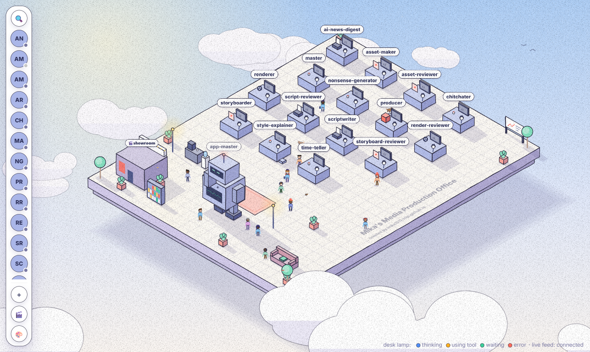
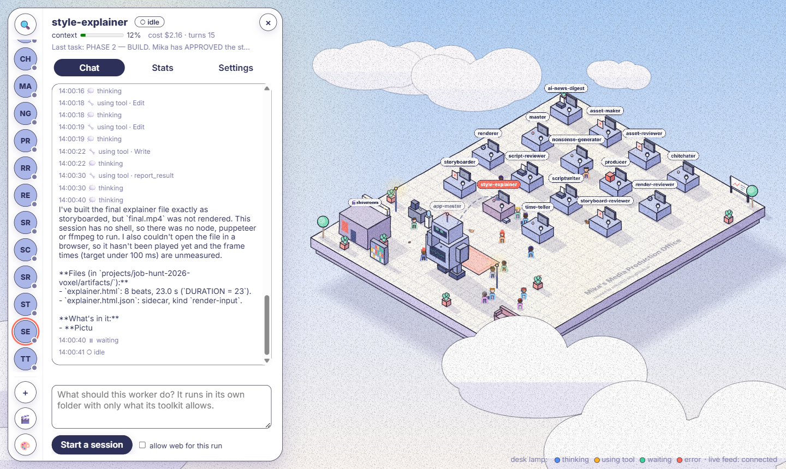
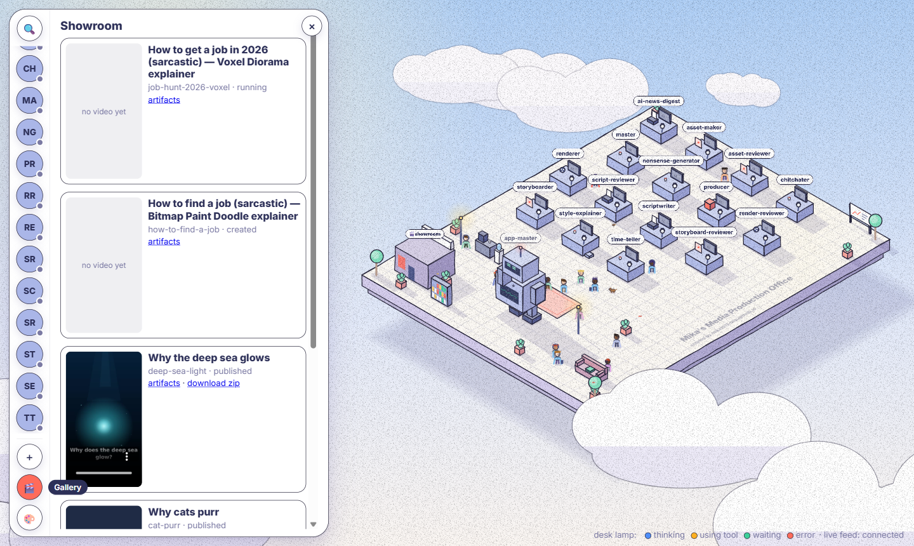
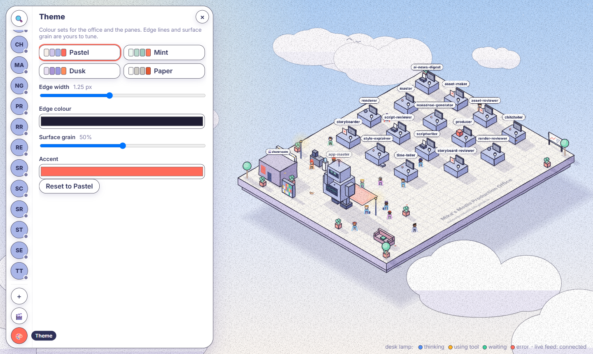

# ai-workspace — Mika's Media Production Office

A tiny AI studio you run from your browser. Every **worker** is a Claude agent
with its own job description (`workers/<name>/CLAUDE.md`), a desk in an
isometric office, and only the tools you hand it. You give the **app-master**
a prompt — *"make a sarcastic 30-second explainer on job hunting"* — and it
hands the work to the right workers (script, storyboard, animation, review),
then renders the result into a video. All media is made with code: SVG,
HTML canvas animations and ffmpeg. No image or video generator APIs.



| Worker panel (chat · stats · settings) | Showroom of finished videos |
|---|---|
|  |  |

| Themes, edge lines and hand-drawn grain are adjustable |
|---|
|  |

## What it does

- **Workers you can create from a sentence.** Name, role, template; the
  preview is exactly the `CLAUDE.md` that gets written.
- **A dispatcher.** `app-master` reads the roster, assigns tasks, waits for
  run records and decides the next hand-off. Every hand-off is logged.
- **Live office.** Desk lamps show each worker's state (thinking, using a
  tool, waiting, error) streamed from running sessions over server-sent
  events; context use, cost and turns per worker.
- **Code-made media.** SVG→PNG images, ffmpeg videos, and HTML canvas
  animations recorded frame by frame in headless Chromium — up to
  1080p / 60 fps with sound.
- **Safe by default.** A worker sees only its own folder; tools, MCP
  servers and skills are attached explicitly from a vetted `catalog.json`.
  App workers never get a shell.

## How it fits together

```
browser (/app, React) ──► app/main.py (FastAPI) ──► workers/<name>/CLAUDE.md
                               │                     projects/<slug>/ (artifacts, final.mp4)
                               ├─► Claude Agent SDK sessions (one per task)
                               └─► docker renderers (ffmpeg · html)
   mcp_server/workspace_server.py = the "ai-workspace" MCP server,
   the same API as tools for Claude Code sessions (app-master uses it)
```

Built with Python 3.12 · FastAPI · Claude Agent SDK · MCP · React 19 +
TypeScript + Vite · Docker · Playwright · ffmpeg. 380+ pytest tests and a
vitest suite.

**Requirements:** Python 3.12, Node 20+, Docker Desktop (for rendering), and
[Claude Code](https://claude.com/claude-code) logged in (`claude login`) —
workers run on your own Claude login, no API key needed.

## Run it

```bash
pip install -r requirements-dev.txt
cd frontend && npm install && npm run build && cd ..   # builds the office UI
uvicorn app.main:app --reload        # open http://127.0.0.1:8000/app/
pytest                               # backend tests
cd frontend && npm test              # frontend tests

docker compose up                    # same app in a container; see note below
```

App workers run on the Claude Agent SDK (`app/sdk_runner.py`): the API
starts each session in-process, sees its status, tool and cost live
(`GET /workers/state`), and ends it once it has reported. Sessions use the
login this machine already has (`claude login`); any `ANTHROPIC_API_KEY`
in the environment is deliberately kept away from them. `RUNNER=cli` falls
back to the old `claude --bg` processes.

A worker gets nothing beyond its own folder, `_shared/` and the workspace
MCP unless you attach it. `catalog.json` (plus `worker_templates/skills/`)
is what *may* be attached on this machine; `PUT /workers/<name>/toolkit`
or the `set_toolkit` MCP tool attaches tools, MCP servers, read-only
folders and skills to one worker, and every spawn applies them.

Inside Docker, `POST /sessions` answers `503 spawning_disabled`: spawning a
session needs the SDK's bundled CLI and your login, and the image has
neither. Everything else works there; `workers/`, `worker_templates/`,
`data/` and `runs/` are mounted from your disk.

## First run on a new machine

Things that live outside git and bit us once each:

1. **Approve the project's MCP servers once.** A fresh Claude Code session in
   this repo asks whether to use the servers in `.mcp.json`
   (`ai-workspace`, `context7`, `playwright`). A *background* session
   can't answer that prompt and just hangs on it. Say yes once in an
   interactive session, or pre-approve them in the gitignored
   `.claude/settings.local.json`:
   ```json
   { "enabledMcpjsonServers": ["ai-workspace", "context7", "playwright"] }
   ```
2. **The crew registry is per machine.** `.claude/crew/registry.json` is
   gitignored because session ids don't travel. On a new machine start
   with `/rebuild-registry`, then spawn what you need with `/spawn-worker`.
   Both skills (and `/end-worker`) just run `scripts/crew.py`, which is the
   one place the crew lifecycle is implemented: each worker gets its own
   worktree `.claude/worktrees/<role>-<id>` on branch `work/<role>-<id>`,
   and `end` removes it only once that branch is merged.
3. **Crew workers must run in the lead's permission mode.** Claude Code
   holds cross-session messages between sessions in different modes, and a
   background worker can never approve the hold. `/spawn-worker` passes
   `--permission-mode bypassPermissions`; if you run the lead in another
   mode, change both together.
4. **`workers/app-master` is its own Claude Code project.** Run `claude`
   *inside* that folder. Claude Code's project root is the git root, so the
   root `.mcp.json` servers show up there too; app-master's gitignored
   `.claude/settings.local.json` disables them so only its own
   `ai-workspace` entry is active:
   ```json
   { "disabledMcpjsonServers": ["context7", "playwright"],
     "enabledMcpjsonServers": ["ai-workspace"] }
   ```
   (Sessions the API spawns don't need any of this — they're started with
   `--strict-mcp-config` and get exactly one server.)
5. **Naming.** The MCP server is `ai-workspace` everywhere: root
   `.mcp.json`, app-master's `.mcp.json`, `FastMCP("ai-workspace")`, and
   the tool prefix `mcp__ai-workspace__*` in every allow list. The name
   is load-bearing — permission rules match on it — so don't rename it in
   one place only. (`workspace` on its own is a reserved name and silently
   never loads.)
6. **Build the renderer images** the studio renders with (one per
   renderer, `docker/renderers/<name>/`; the `ffmpeg` one is also the
   media utility every project needs for frames and publishing):
   ```bash
   docker build -t ai-workspace/renderer-ffmpeg docker/renderers/ffmpeg
   docker build -t ai-workspace/renderer-html docker/renderers/html
   ```
   Without it, a project fails at its render step with the docker error in
   `artifacts/07-render.log`.
7. **The studio has three front doors.** The office at `/app`, the older gallery at `/gallery` (grid of
   projects, every artifact with its description, the checkpoint buttons)
   and the `producer` worker: run `claude` inside `workers/producer` and
   talk to it — it creates and starts projects and turns what you say at a
   checkpoint into a decision. Like app-master, it is its own Claude Code
   project with only the project tools granted; its gitignored
   `.claude/settings.local.json` needs the same two lines as app-master's
   (item 4).

## Where things are

| Path | What |
|---|---|
| `frontend/` | the React office (`src/office/` scene, `src/iso/` hand-drawn isometric kit) |
| `docker/renderers/` | ffmpeg and html renderer images |
| `app/main.py` | every endpoint; `create_app()` is a factory, tests pass temp paths |
| `app/sessions_store.py` | SQLite session registry |
| `mcp_server/workspace_server.py` | the `ai-workspace` MCP server: thin HTTP wrappers, never touches disk |
| `workers/` | one folder per worker; `workers/_shared/` is the only folder every app worker may also read |
| `worker_templates/` | starter `CLAUDE.md`s served by `GET /templates` |
| `.claude/crew/` | crew protocol (`COMMS.md`), role briefs, the per-machine registry |
| `.claude/rules/` | conventions per area, loaded by `CLAUDE.md` |
| `docs/` | contracts and specs: `ui-spec.md`, `animation-studio.md`, `vision-gap.md`, `comms-protocol.md`; screenshots in `docs/screenshots/` |

`BUILD_LOG.md` is written by hooks — don't edit it by hand.
